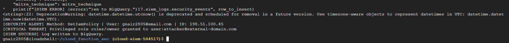
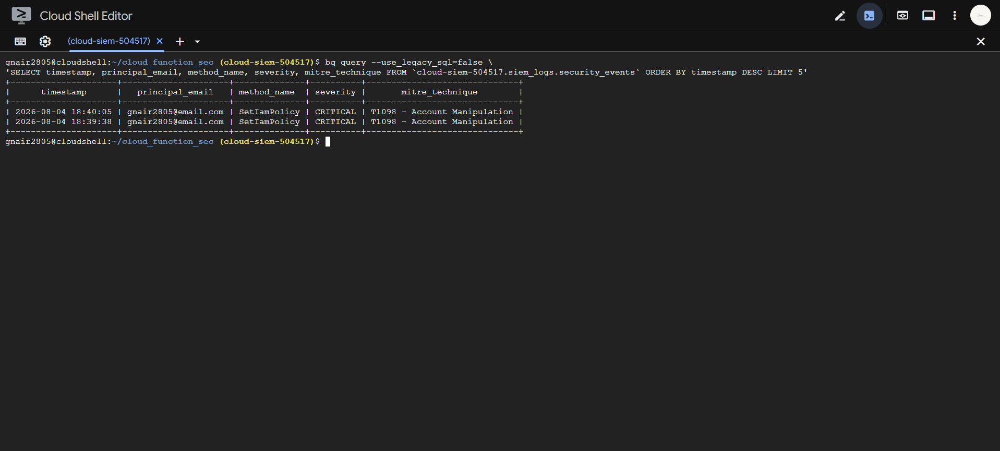

# Automated Cloud Incident Response & SIEM Pipeline on GCP

## Executive Summary
In enterprise cloud environments, compromised IAM credentials allow attackers to execute valid administrative actions—such as granting elevated permissions or creating rogue service account keys—without triggering traditional operating system alarms. 

This project implements a **serverless, event-driven SIEM & SOAR pipeline** on Google Cloud Platform. It ingests GCP audit logs in real time, parses threat metadata, maps malicious activity to the **MITRE ATT&CK for Cloud Matrix**, streams structured events into **BigQuery**, and flags critical security threats for automated containment.

---

## Tech Stack & Architecture
* **Cloud Infrastructure:** GCP Cloud Logging, Cloud Pub/Sub, Cloud Functions (Gen 2), BigQuery
* **Security Framework:** MITRE ATT&CK Matrix for Cloud (T1098, T1078)
* **Languages & Automation:** Python 3.11, SQL, Google Cloud SDK

### Data Flow
1. **Telemetry Ingestion:** GCP Cloud Logging captures administrative write events (`protoPayload`).
2. **Filtered Routing:** Log Router Sink filters specific IAM modifications (`SetIamPolicy`, `CreateServiceAccountKey`) and streams them to Cloud Pub/Sub.
3. **Stream Processing:** A Python Cloud Function (Gen 2) receives base64 CloudEvents, decodes the audit payload, and extracts principal metadata (`who`, `what`, `caller_ip`).
4. **Threat Intelligence Mapping:** Evaluates policy deltas for privilege escalation (e.g., granting `roles/owner`) and assigns severity + MITRE ATT&CK IDs.
5. **SIEM Storage:** Streams structured JSON records into BigQuery for real-time SQL threat hunting.

---

## MITRE ATT&CK Threat Mapping Matrix

| Audit Event | Detected Pattern | Assigned Severity | MITRE ATT&CK Technique | ID |
| :--- | :--- | :--- | :--- | :--- |
| `SetIamPolicy` | Over-privileged role assignment (`roles/owner` or `roles/editor`) | **CRITICAL** | Account Manipulation | **T1098** |
| `SetIamPolicy` | Standard IAM permission update | **HIGH** | Account Manipulation | **T1098** |
| `CreateServiceAccountKey` | Long-term API key generation | **HIGH** | Valid Accounts: Cloud Accounts | **T1078.004** |

---

## Proof of Execution & Ingestion

### 1. Threat Detection Engine Execution
The detection worker parses an incoming `SetIamPolicy` payload, detects an unauthorized `roles/owner` assignment, flags the event as `CRITICAL`, and streams it to the SIEM data store.



### 2. BigQuery SIEM Security Event Log
Structured incident telemetry stored in BigQuery, ready for security analyst threat hunting.



```sql
SELECT timestamp, principal_email, method_name, severity, mitre_technique 
FROM `cloud-siem-504517.siem_logs.security_events` 
ORDER BY timestamp DESC LIMIT 5;
